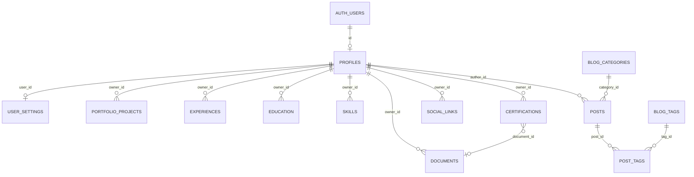
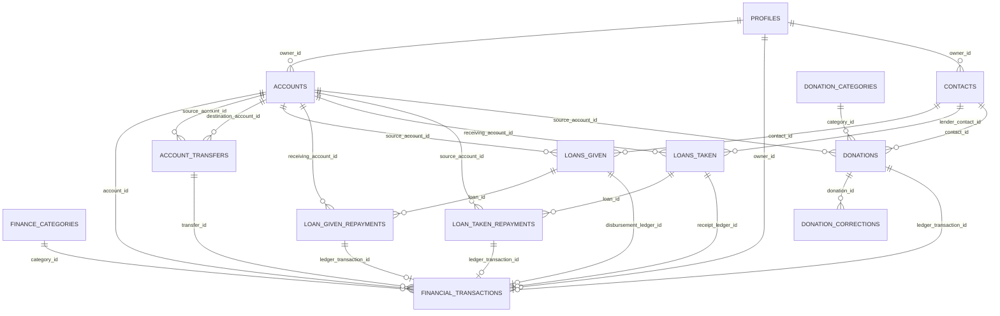
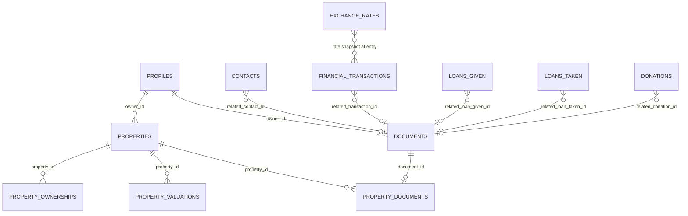

# Sadi-Hub — Architecture, Database, Security & Delivery Plan

Status: **Implemented through Phase 8 (Finalization).** The application, schema, exports, backups, CI checks and operational runbooks are in place. The final production migration/deploy remains an operator action because it requires live Supabase and Cloudflare credentials. The original plan is retained below as the architecture and acceptance reference.

Repository: `/home/vmdev/sadi/Sadi-Hub` (empty Git repo, remote `https://github.com/mdsksadi/Sadi-Hub.git`)

Date: 2026-11-24

---

## 0. Executive summary

A **modular monolith** (single Next.js App Router application) deployed to **Cloudflare Workers via `@opennextjs/cloudflare`**, backed by **Supabase Postgres + Auth + Storage**. All private data is owned by exactly one account and protected by **RLS on every table and storage object**, plus **server-side authorization on every read and mutation**.

The financial core is an **append-only, typed cash ledger**. Business modules (lending, borrowing, donations, transfers) each create their ledger rows inside a **single atomic PostgreSQL function call**, so a business record can never exist without its cash movement, and cash can never move twice.

Money is stored as `NUMERIC`, always with an explicit currency. EUR and BDT are never summed directly; consolidated figures use **snapshotted historical exchange rates** and are clearly labeled as translated values.

---

## 1. Verified platform decisions (checked against official docs today)

| Topic | Verified fact | Decision |
|---|---|---|
| OpenNext + Cloudflare | `@opennextjs/cloudflare` supports **Next.js 16** and the **latest minor of Next.js 15**; Next 14 is EOL. App requires the **Node.js runtime** (not Edge runtime for app code). | Next.js 16.x, Node.js runtime, pinned adapter version. |
| Middleware | Standard middleware is supported; **Node-runtime middleware (`proxy.ts` with Node runtime) is experimental** since adapter 1.20.3. Next.js 16 renames `middleware.ts` → `proxy.ts`. | Use the default **Edge-runtime `proxy.ts`** only for Supabase cookie refresh + rate limiting + security headers. No experimental Node middleware. |
| Worker limits | Free plan Worker bundle limit is **3 MiB compressed** (10 MiB paid). | Lazy-load Recharts/PDF code in admin routes only; monitor compressed size in CI; flag if a paid plan becomes necessary. |
| Node APIs on Workers | Compatibility date **≥ 2026-08-04** enables `nodejs_compat` / `nodejs_compat_v2` by default. | Set `compatibility_date = "2026-08-04"` (or later) in `wrangler.jsonc`; no legacy flags needed. |
| ISR / revalidation | Needs R2 incremental cache + DO queue (+ D1 tag cache for on-demand revalidation); KV is discouraged (eventual consistency). | Small-site config: R2 + DO queue + D1 tag cache. Fallback: dynamic SSR with `no-store` if free-tier bindings are unwanted. |
| Supabase SSR | Use `getClaims()` to verify identity; **never trust `getSession()` in server code**. Refresh token in `proxy.ts` and copy `Cache-Control`/`Expires`/`Pragma` onto the response. | Follow exactly; admin responses get `Cache-Control: private, no-store`. |
| Supabase keys | Docs use `NEXT_PUBLIC_SUPABASE_PUBLISHABLE_KEY` (plus project URL). | Use publishable key in browser-safe env only; service role key never in the Worker or browser (CI/backups only). |
| Storage | Policies on `storage.objects` govern upload/download/list/signed-URL creation, including private buckets. Signed URLs skip policy checks at download time because policies were checked at creation. | Private buckets + `storage.objects` policies scoped to `auth.uid()` + owner; short-lived (60–300 s) signed URLs minted server-side. |
| PDF on Workers | No headless Chrome by default; native/Node PDF stacks are risky. | Use pure-JS `pdf-lib` for generated reports; browser print stylesheet as a secondary "print to PDF" path. |

### Proposed changes to the requested stack (for approval)

1. **Drizzle/Prisma over a TCP connection → PL/pgSQL RPC functions + PostgREST.** Workers cannot hold a direct Postgres TCP connection without extra infrastructure (Hyperdrive). Atomic multi-table financial operations are implemented as PostgreSQL functions called via `supabase.rpc()` with the caller's JWT, so RLS still applies and the whole operation is one DB transaction. Plain CRUD uses PostgREST directly.
2. **Single `ledger` concept added** (the requested "unified financial transaction ledger"). This is an addition, not a replacement, and is required to satisfy accounting rules 1–10 and avoid double counting.
3. **Markdown editor** (textarea + live preview + `react-markdown`/`rehype-sanitize`/`rehype-highlight`) instead of a heavy WYSIWYG. Gives code blocks, tables, images, draft/publish, and predictable Workers compatibility.
4. **`pdf-lib`** for PDF export instead of Puppeteer/headless browsers.
5. **`proxy.ts`** (Next 16 name) instead of `middleware.ts`.

---

## 2. Final architecture

```
Browser
  │  HTTPS
  ▼
Cloudflare Edge (Workers + Static Assets + WAF rate limiting)
  │
  ├─ proxy.ts (Edge): Supabase token refresh via getClaims(),
  │                   security headers, no-store for /admin/*,
  │                   auth/login rate limiting, Origin checks
  ▼
Next.js 16 App Router (Node.js runtime) — ONE deployable Worker
  │
  ├─ app/(site)/*       public: portfolio, blog, resume, contact
  ├─ app/admin/*        private: Server Components + Server Actions
  ├─ app/api/*          Route Handlers: signed URLs, CSV/PDF, RSS, sitemap
  │
  ├─ lib/auth/          requireOwner(), getVerifiedClaims()
  ├─ lib/domain/        PURE money math, status/overdue calculators (unit tested)
  ├─ lib/validation/    Zod schemas shared by actions and tests
  ├─ lib/data/          thin Supabase query adapters (no business logic)
  └─ lib/services/      orchestration: calls domain + data + RPC in one unit
  ▼
@opennextjs/cloudflare  (R2 incremental cache, DO queue, D1 tag cache)
  ▼
Supabase
  ├─ PostgreSQL (tables, constraints, views, RPC functions, triggers, RLS)
  ├─ Auth (email+password, MFA/TOTP, signups disabled, single owner)
  └─ Storage (public: avatars/portfolio; private: documents, property docs)
```

### Layer rules

- **UI** (`app/`, `components/`) never imports Supabase directly except through `lib/data` / `lib/services`.
- **Business logic** lives in `lib/domain` as pure functions (no I/O) and in PL/pgSQL RPCs for atomic operations. Never duplicate a calculation in a component.
- **Data access** (`lib/data`) owns query shapes and generated types; it performs no authorization decisions of its own beyond passing the verified user context.
- **Migrations** (`supabase/migrations/`) are the only place schema changes happen. No runtime `CREATE TABLE`.

### Route map (unchanged from requirements)

Public: `/`, `/about`, `/experience`, `/education`, `/skills`, `/projects`, `/projects/[slug]`, `/blog`, `/blog/[slug]`, `/contact`, `/resume`, plus `rss.xml`, `sitemap.xml`, `robots.txt`.

Private: `/admin/login`, `/admin/dashboard`, `/admin/profile`, `/admin/portfolio`, `/admin/blog`, `/admin/blog/new`, `/admin/blog/[id]/edit`, `/admin/finance` (+ `accounts`, `transactions`, `transfers`, `lending`, `borrowing`, `donations`, `reports`), `/admin/property`, `/admin/property/[id]`, `/admin/documents`, `/admin/settings`, `/admin/audit-logs`.

---

## 3. Complete database schema

### 3.1 Conventions

- All tables use `uuid PRIMARY KEY DEFAULT gen_random_uuid()` (except explicit join tables).
- Every table with private data has `owner_id uuid NOT NULL REFERENCES profiles(id) ON DELETE RESTRICT`, indexed, and an RLS policy `owner_id = (select auth.uid())`.
- Money: `NUMERIC(18,4)` (`NUMERIC(14,2)` for percentages/rates where appropriate). `CHECK (amount > 0)` on all movement amounts.
- Business dates: `DATE`. Event timestamps: `TIMESTAMPTZ DEFAULT now()`.
- Currency: `CHAR(3)` ISO 4217, checked against a `currencies` seed list; configurable for future currencies.
- Delete strategy: `DELETE` is not granted to clients on financial tables. Use `cancelled_at`/`reversal_of` and audit entries. Portfolio/blog may be soft-deleted with `deleted_at`.
- Generated types: `supabase gen types typescript` → `types/supabase.ts`, regenerated in CI after migrations.

### 3.2 Tables (full column inventory)

#### Authentication & system

**`profiles`** — `id` (PK → `auth.users.id`), `email`, `display_name`, `role TEXT CHECK (role IN ('owner'))`, `status TEXT CHECK (status IN ('active','suspended'))`, `headline`, `bio_md`, `location`, `timezone`, `avatar_path`, `resume_path`, `resume_updated_at`, `created_at`, `updated_at`.
> Exactly one row with `role='owner'` is provisioned manually. Signups disabled.

**`user_settings`** — `user_id` PK/FK → profiles, `reporting_currency CHAR(3) DEFAULT 'EUR'`, `theme`, `date_format`, `locale`, `mfa_enforced BOOLEAN DEFAULT true`, `reporting_notes`, `updated_at`.

**`audit_logs`** (append-only) — `id`, `actor_id UUID`, `action TEXT`, `table_name TEXT`, `record_id UUID`, `old_data JSONB`, `new_data JSONB`, `reason TEXT`, `occurred_at TIMESTAMPTZ`. No client UPDATE/DELETE grants; populated by triggers + explicit business events.

**`currencies`** — `code CHAR(3) PK`, `name`, `minor_units`, `is_active`. Seed: EUR, BDT (+ easily extendable).

**`exchange_rates`** — `id`, `from_currency CHAR(3)`, `to_currency CHAR(3)`, `rate NUMERIC(18,8) CHECK (rate > 0)`, `effective_date DATE`, `source TEXT`, `created_at`; `UNIQUE (from_currency, to_currency, effective_date)`; index `(from_currency, to_currency, effective_date DESC)`.

#### Portfolio

**`portfolio_projects`** — `id`, `owner_id`, `title`, `slug` (unique per owner), `short_description`, `description_md`, `tech_stack TEXT[]`, `github_url`, `demo_url`, `image_path`, `start_date`, `completion_date`, `sort_order INT`, `is_featured BOOL`, `is_published BOOL`, `deleted_at`, timestamps. Index `(owner_id, is_published, sort_order)`.

**`experiences`** — `id`, `owner_id`, `company`, `position`, `start_date`, `end_date`, `is_current BOOL`, `responsibilities TEXT[]`, `technologies TEXT[]`, `sort_order`, `deleted_at`, timestamps.

**`education`** — `id`, `owner_id`, `institution`, `degree`, `field_of_study`, `start_date`, `end_date`, `description_md`, `sort_order`, `deleted_at`, timestamps.

**`skills`** — `id`, `owner_id`, `name`, `category`, `proficiency SMALLINT CHECK (1..5)`, `icon`, `sort_order`, `deleted_at`, timestamps.

**`certifications`** — `id`, `owner_id`, `name`, `issuer`, `issued_on DATE`, `expires_on DATE`, `credential_url`, `document_id UUID` (→ documents), `sort_order`, timestamps.

**`social_links`** — `id`, `owner_id`, `platform`, `url`, `sort_order`; `UNIQUE (owner_id, platform)`.

#### Blog

**`blog_categories`** — `id`, `owner_id`, `name`, `slug`, `description`; `UNIQUE (owner_id, slug)`.

**`blog_tags`** — `id`, `owner_id`, `name`, `slug`; `UNIQUE (owner_id, slug)`.

**`posts`** — `id`, `owner_id`, `author_id` → profiles, `title`, `slug`, `excerpt`, `content_md TEXT`, `cover_path`, `category_id` → blog_categories, `status TEXT CHECK (status IN ('draft','scheduled','published','archived'))`, `published_at TIMESTAMPTZ`, `scheduled_for TIMESTAMPTZ`, `seo_title`, `seo_description`, `is_featured BOOL`, `reading_minutes INT GENERATED ALWAYS AS (greatest(1, ceil(length(content_md)/1200.0))) STORED`, `deleted_at`, timestamps; `UNIQUE (owner_id, slug)`. Index `(owner_id, status, published_at DESC)`.

**`post_tags`** — `post_id` → posts ON DELETE CASCADE, `tag_id` → blog_tags ON DELETE CASCADE, PK `(post_id, tag_id)`.

> Public SELECT policy: `status='published' AND published_at <= now() AND deleted_at IS NULL`. Scheduled publishing is completed by a scheduled GitHub Action / Cloudflare cron calling an RPC that flips `scheduled → published` at due time (no background process inside Workers needed).

#### Contacts

**`contacts`** — `id`, `owner_id`, `full_name`, `contact_type CHECK ('individual','organization')`, `phone`, `email`, `address`, `country_code`, `notes`, `archived_at`, timestamps; index `(owner_id, lower(full_name))`. This single table is reused by loans given, loans taken, donations, and property ownership where applicable.

#### Finance core

**`accounts`** — `id`, `owner_id`, `name`, `country_code`, `currency_code`, `account_type CHECK ('bank','savings','cash','mobile_money','other')`, `opening_balance NUMERIC(18,4) NOT NULL DEFAULT 0`, `opening_date DATE`, `description`, `is_active BOOL DEFAULT true`, timestamps; `UNIQUE (owner_id, name)`. Index `(owner_id, country_code, currency_code)`.

**`finance_categories`** — `id`, `owner_id`, `name`, `kind CHECK ('income','expense')`, `parent_id` self-FK, `icon`, `is_active`, timestamps; `UNIQUE (owner_id, kind, name)`.

**`financial_transactions`** — the append-only ledger. Columns: `id`, `owner_id`, `account_id` → accounts, `transaction_type TEXT CHECK (transaction_type IN ('income','expense','transfer_out','transfer_in','loan_disbursed','loan_repayment_received','borrowing_received','borrowing_repayment_paid','donation','correction','reversal'))`, `direction SMALLINT CHECK (direction IN (-1,1))`, `amount NUMERIC(18,4) CHECK (amount > 0)`, `currency_code CHAR(3)`, `business_date DATE`, `category_id` nullable → finance_categories, `transfer_id` nullable → account_transfers, `reference_type TEXT`, `reference_id UUID`, `description`, `notes`, `attachment_path`, `reverses_transaction_id` self-FK nullable, `is_reversal BOOL DEFAULT false`, `exchange_rate_to_reporting NUMERIC(18,8) CHECK (> 0)`, `reporting_currency CHAR(3)`, `amount_reporting NUMERIC(18,4)`, `created_at`, `created_by UUID`. Indexes: `(owner_id, business_date DESC)`, `(owner_id, account_id, business_date)`, `(owner_id, reference_type, reference_id)`, `(owner_id, transaction_type, business_date)`. No UPDATE/DELETE grants to `authenticated`.

**`account_transfers`** — `id`, `owner_id`, `source_account_id`, `destination_account_id`, `source_amount`, `source_currency`, `destination_amount`, `destination_currency`, `exchange_rate`, `fee_amount NUMERIC DEFAULT 0`, `transfer_date DATE`, `reference_number`, `notes`, `out_ledger_id`, `in_ledger_id`, `fee_ledger_id` (nullable), timestamps. `CHECK (source_account_id <> destination_account_id)`.

#### Lending (money I lend — receivable)

**`loans_given`** — `id`, `owner_id`, `contact_id` → contacts, `amount NUMERIC(18,4) CHECK (>0)`, `currency_code`, `date_given DATE`, `reason`, `payment_method`, `source_account_id` → accounts, `expected_repayment_date DATE`, `reference_number`, `notes`, `cancelled_at TIMESTAMPTZ`, `disbursement_ledger_id UUID UNIQUE` → financial_transactions, timestamps. Index `(owner_id, contact_id, date_given DESC)`.

**`loan_given_repayments`** — `id`, `owner_id`, `loan_id` → loans_given, `amount NUMERIC(18,4) CHECK (>0)`, `repayment_date DATE`, `receiving_account_id` → accounts, `payment_method`, `reference_number`, `notes`, `ledger_transaction_id UUID UNIQUE` → financial_transactions, `cancelled_at`, `created_at`. Index `(owner_id, loan_id, repayment_date)`.

#### Borrowing (money I borrow — payable)

**`loans_taken`** — `id`, `owner_id`, `lender_contact_id` → contacts, `amount`, `currency_code`, `date_borrowed DATE`, `reason`, `expected_repayment_date DATE`, `receiving_account_id` → accounts, `agreement_details`, `notes`, `cancelled_at`, `receipt_ledger_id UUID UNIQUE`, timestamps.

**`loan_taken_repayments`** — `id`, `owner_id`, `loan_id` → loans_taken, `amount`, `payment_date DATE`, `source_account_id` → accounts, `payment_method`, `notes`, `ledger_transaction_id UUID UNIQUE`, `cancelled_at`, `created_at`.

#### Donations (immutable)

**`donation_categories`** — `id`, `owner_id`, `name`, `slug`; seed: charity, mosque, orphanage, education, medical_support, family_assistance, disaster_relief, religious, community, other.

**`donations`** — `id`, `owner_id`, `contact_id` nullable → contacts, `recipient_name TEXT` (snapshot), `recipient_type CHECK ('individual','organization')`, `amount`, `currency_code`, `donation_date DATE`, `purpose`, `category_id` → donation_categories, `country_code`, `source_account_id`, `payment_method`, `reference_number`, `notes`, `ledger_transaction_id UUID UNIQUE`, `created_at`, `created_by`. No UPDATE/DELETE grants. Corrections only through the table below.

**`donation_corrections`** — `id`, `owner_id`, `donation_id` → donations, `correction_type CHECK ('reversal','adjustment')`, `amount`, `reason`, `ledger_transaction_id UNIQUE`, `created_at`. Original donation row is never changed.

#### Property

**`properties`** — `id`, `owner_id`, `name`, `country_code`, `division`, `district`, `upazila`, `union_name`, `village`, `mouza`, `khatian_number`, `dag_number`, `land_classification`, `total_area NUMERIC(18,4)`, `area_unit TEXT` (original unit preserved), `purchase_date`, `purchase_price NUMERIC(18,4)`, `currency_code`, `current_estimated_value NUMERIC(18,4)`, `notes`, timestamps. Index `(owner_id, country_code, district)`.

**`property_ownerships`** — `id`, `owner_id`, `property_id` → properties ON DELETE CASCADE, `owner_name`, `ownership_percentage NUMERIC(5,2) CHECK (> 0 AND <= 100)`, `acquisition_date`, `ownership_type`, `notes`. Trigger enforces `SUM(ownership_percentage) = 100.00` per property on INSERT/UPDATE/DELETE.

**`property_documents`** — `id`, `property_id` → properties, `document_id` → documents, `document_type CHECK ('deed','khatian','mutation','tax_receipt','agreement','map','other')`, `issued_on`, `notes`.

**`property_valuations`** — `id`, `property_id`, `estimated_value NUMERIC(18,4)`, `currency_code`, `valued_on DATE`, `source TEXT`, `is_verified BOOL DEFAULT false` (estimated values are **never** presented as verified market prices), `notes`, `created_at`.

**`unit_conversions`** — `id`, `from_unit TEXT`, `to_unit TEXT`, `factor NUMERIC(18,8)`, `source_note`, `valid_from DATE`; `UNIQUE (from_unit, to_unit, valid_from)`. Configurable; no assumed universal Katha/Bigha factor; original unit always preserved on `properties`.

#### Documents

**`documents`** — `id`, `owner_id`, `storage_path`, `file_name`, `mime_type`, `size_bytes BIGINT`, `category TEXT`, `description`, `uploaded_at`, `related_contact_id`, `related_transaction_id`, `related_property_id`, `related_loan_given_id`, `related_loan_taken_id`, `related_donation_id`, `tags TEXT[]`. Indexes on owner + each FK. Storage objects are addressed as `<owner_id>/<uuid>-<filename>`; RLS checks `(storage.foldername(name))[1] = (select auth.uid())::text`.

### 3.3 Computed views (no stored derived state)

| View | Purpose |
|---|---|
| `account_balances_v` | `opening_balance + SUM(direction * amount)` per account; indexes make this cheap. |
| `loans_given_status_v` | Adds `total_repaid`, `outstanding = amount - total_repaid`, and status: `cancelled → Cancelled`, `outstanding <= 0 → Fully Repaid`, `outstanding < amount → Partially Repaid`, `expected_repayment_date < today AND outstanding > 0 → Overdue`, else `Pending`. |
| `loans_taken_status_v` | Same with `Active / Partially Repaid / Fully Repaid / Overdue / Cancelled`. |
| `contact_lending_summary_v` | Per contact: total lent, total repaid, outstanding, overdue, loan count, first/last dates (powers contact-wise history). |
| `contact_donation_summary_v` | Per recipient: total donated, count, first/last date, currency/country breakdown. |
| `monthly_cashflow_v` | income vs expense by month/country/currency; **excludes** transfers and loan principal movements. |
| `net_worth_v` | Cash + property estimated values + outstanding receivables − outstanding payables, converted to a chosen reporting currency using snapshotted rates. |

Net worth formula (explicitly non-double-counting):
```
cash (all accounts)
+ latest property estimated values (flagged ESTIMATED)
+ outstanding loans_given (receivables)
− outstanding loans_taken (payables)
= net worth (translated to reporting currency, with rates disclosed)
```
Not added again: donation amounts (already expenses), loan principal cash movements (already in cash/receivable), transfer legs (net zero), historical purchase prices (superseded by estimated value).

Income/expense classification for reports:
- **Income:** `income`, donation `reversal` refunds
- **Expense:** `expense`, `donation`, donation `correction` adjustments
- **Cash-only / neutral:** `transfer_out`, `transfer_in`, `loan_disbursed`, `loan_repayment_received`, `borrowing_received`, `borrowing_repayment_paid`

### 3.4 Atomic RPC functions (all `SECURITY INVOKER`, so RLS applies)

`create_income`, `create_expense`, `create_transfer`, `create_loan_given`, `record_loan_given_repayment`, `create_loan_taken`, `record_loan_taken_repayment`, `create_donation`, `correct_donation`, `add_property_owner`, `record_property_valuation`, `publish_scheduled_posts`, `get_dashboard_summary(filters)`, `get_net_worth(as_of, reporting_currency)`.

Every financial RPC:
1. Calls `require_owner()` (auth + role gate).
2. Locks affected rows with `SELECT ... FOR UPDATE`.
3. Computes remaining balance; rejects `p_amount > remaining` (overpayment) with a SQL exception.
4. Inserts business row + ledger row(s) + audit entry in the **same transaction**.
5. Returns the created IDs.

A database trigger is added as a backstop so a repayment cannot be inserted directly with a total exceeding the loan amount, even if the RPC is bypassed.

---

## 4. ER diagrams

### 4.1 Public content & identity



### 4.2 Finance, lending, borrowing, donations



### 4.3 Property & documents



---

## 5. Security plan

### 5.1 Identity & access

- Disable public signup in Supabase Auth; no signup route exists.
- Provision exactly one `profiles` row with `role='owner'`; `is_owner()` helper = `exists (select 1 from profiles where id = (select auth.uid()) and role='owner' and status='active')`, `SECURITY DEFINER`, pinned `search_path`, granted only to `authenticated`.
- Enforce MFA (TOTP) for the owner: `proxy.ts` checks the `aal` claim for `/admin/*`; Server Components re-check via `requireOwner()`.
- Password policy ≥ 12 chars + breach check (Supabase password settings + Zod on the login/settings forms).
- `getClaims()` for all authorization; `getSession()` only where a raw token is genuinely needed.
- Session cookies: `HttpOnly`, `Secure`, `SameSite=Lax`, short-lived access token + proxy refresh; admin responses `Cache-Control: private, no-store`; propagate the `Cache-Control`/`Expires`/`Pragma` headers Supabase returns on refresh so CDNs never cache session responses.

### 5.2 RLS matrix

| Table group | anon | authenticated (non-owner) | owner |
|---|---|---|---|
| Public portfolio/blog tables | SELECT published rows only | same | ALL |
| All private tables | none | none | ALL via `owner_id = (select auth.uid()) AND is_owner()` |
| `audit_logs` | none | none | SELECT only (no UPDATE/DELETE) |
| `financial_transactions`, `donations`, corrections | none | none | INSERT via RPC + SELECT; no direct UPDATE/DELETE |
| `storage.objects` private buckets | none | none | SELECT/INSERT/UPDATE/DELETE where folder = `auth.uid()` AND `is_owner()` |
| `storage.objects` public buckets | SELECT permitted objects | SELECT | ALL |

- `service_role` is used **only** by CI migrations and encrypted backup jobs — never in application runtime, never in `NEXT_PUBLIC_*`, never in a client bundle.
- All RPCs are `SECURITY INVOKER`; `SECURITY DEFINER` only for `is_owner()` with pinned `search_path` and revoked public execute.

### 5.3 Application-layer protections

- Zod validation on every Server Action / Route Handler input; reject unknown fields; cap upload size/type.
- CSRF: Server Actions' built-in Origin check + explicit `Origin`/`Sec-Fetch-Site` verification on mutating Route Handlers; `SameSite=Lax` cookies; no state changes via GET.
- Rate limiting: Cloudflare WAF rules for `/admin/login` and public forms; app-level sliding window backed by Cloudflare KV for defense in depth (in-memory is insufficient on Workers).
- Signed URLs: minted server-side with 60–300 s expiry; no bucket URL ever rendered in public HTML.
- Structured server-side logging with redaction; error messages returned to clients never include SQL or stack details.
- Dependency scanning: `npm audit` + Dependabot weekly; pin majors, review minor bumps.

### 5.4 Security tests (automated)

- RLS tests using local Supabase: `anon` and a second authenticated non-owner user cannot SELECT/INSERT/UPDATE/DELETE any private table or storage object.
- Owner can perform all allowed operations; owner cannot UPDATE a donation or ledger row directly.
- Attempted overpayment through RPC and direct INSERT both fail.
- Signed URL expiry and private-bucket direct access tests.
- Cookie/cache header assertions on `/admin/*` responses; no `service_role` string in built client bundles (grep in CI).

---

## 6. Backup & recovery strategy

- **Nightly logical backup** via GitHub Actions: `pg_dump --format=custom` against Supabase, encrypted with **age** (recipient public key stored in repo is safe; private key only in owner's secure storage), uploaded to a **private** R2 bucket or the owner's encrypted store. Never public.
- **Retention:** 30 daily, 12 monthly; backup verification = automated restore into a local Supabase container + row-count/checksum comparison, reported to the owner.
- **In-app exports:** CSV for all ledger/loan/donation/property lists; `pdf-lib` reports for monthly/yearly financial summaries.
- **Document backups:** private bucket mirrored to the same encrypted R2 location with versioning.
- **Runbook** (`docs/BACKUP.md`): prerequisites, restore to local, restore to fresh Supabase project, verify, rotate keys, and post-restore RLS checks.
- Supabase free projects pause after inactivity; keep-alive or paid plan decision documented in README.

---

## 7. Testing strategy

| Layer | Tool | Scope |
|---|---|---|
| Pure domain unit tests | Vitest | Money math, currency conversion, balance/status/overdue calculations, ownership % validation, reading time, slug rules. |
| DB integration tests | Vitest + local Supabase | RPC atomicity, rollback on failure, constraints, triggers, views, overpayment prevention, EUR/BDT separation. |
| RLS/security tests | Vitest + Supabase anon/owner/foreign JWT | Matrix in §5.4. |
| Component tests | React Testing Library | Forms, validation messages, empty/loading/error states. |
| E2E | Playwright | Publish a blog post → visible publicly, draft invisible; create income/expense/transfer → balances; loan + 3 partial repayments → outstanding and overdue; donation recipient totals; property + owners + valuation; login/MFA guard. |
| CI gates | GitHub Actions | typecheck, lint, tests, Worker compressed size, secret scan, `npm audit`, build + OpenNext preview deploy before production. |

Local Supabase requires Docker; document as a prerequisite.

---

## 8. Deployment architecture & CI/CD

```
main ──► CI: install → lint → typecheck → Vitest (unit) → supabase db reset + integration/RLS tests
            → next build → opennext build → check Worker gzip size ≤ 3 MiB
            → deploy preview to workers.dev → Playwright smoke → manual approval
            → supabase db push (production, migrations) → deploy production Worker
develop ──► same minus production deploy; preview on every push
feature/*, fix/* ──► PR into develop
```

- Secrets: GitHub Environments (`development`, `production`) hold `SUPABASE_ACCESS_TOKEN`, `SUPABASE_DB_PASSWORD`, `CLOUDFLARE_API_TOKEN`, `CLOUDFLARE_ACCOUNT_ID`, backup encryption key. Cloudflare Worker runtime secrets set via `wrangler secret put` (never in repo or `.env.example` values).
- `.env.example` contains placeholders only: `NEXT_PUBLIC_SITE_URL`, `NEXT_PUBLIC_SUPABASE_URL`, `NEXT_PUBLIC_SUPABASE_PUBLISHABLE_KEY`, `SUPABASE_SERVICE_ROLE_KEY` (CI/backups only), `CACHE_PURGE_*`, etc.
- `wrangler.jsonc`: `compatibility_date = "2026-08-04"`, static assets binding, `WORKER_SELF_REFERENCE`, R2 incremental cache, DO queue, D1 tag cache; `public/_headers` sets immutable caching for `/_next/static/*`.
- Public pages use time-based ISR; admin pages are always dynamic `no-store`.

---

## 9. Implementation roadmap (detailed task list)

### Phase 0 — Approval & bootstrap (after your go-ahead)
- [ ] Confirm open decisions (§10), create `develop` branch from `main`.
- [ ] `create-next-app` (Next 16, TS strict, Tailwind, App Router, `src/`), ESLint/Prettier, shadcn/ui, Lucide, Zod, Vitest, RTL, Playwright.
- [ ] Add OpenNext Cloudflare adapter, `wrangler.jsonc`, `open-next.config.ts`, `public/_headers`.
- [ ] Add Supabase CLI config, `.env.example`, `docs/PLAN.md`.
- [ ] CI skeleton (lint/typecheck/test/build); GitHub branch protection.
- **Exit gate:** local `next build` + `opennext build` deploy to a workers.dev preview; health check passes.

### Phase 1 — Foundation & auth
- [ ] Migrations: `profiles`, `user_settings`, `audit_logs`, `currencies`, `exchange_rates`, `is_owner()`, RLS helpers, triggers.
- [ ] Supabase clients (browser/server/proxy), `proxy.ts` with `getClaims()` + refresh + headers + rate limit.
- [ ] `requireOwner()` in `lib/auth`, `/admin/login`, MFA enforcement, `/admin` layout with sidebar/topbar, dark mode.
- [ ] Security tests for unauthenticated/non-owner denial; cache header assertions.
- **Exit gate:** owner can log in with MFA; foreign/unauthenticated users cannot reach any `/admin` route or private row.

### Phase 2 — Public portfolio
- [ ] Migrations for portfolio tables + published-row RLS; seed content via admin forms.
- [ ] Homepage, About, Experience, Education, Skills, Projects + `[slug]`, Resume (PDF from private storage via signed URL proxy), Contact (rate-limited).
- [ ] Metadata, OG, canonical, structured data, sitemap/robots, responsive design, accessibility pass.
- [ ] Component + E2E tests for public visibility and resume access.

### Phase 3 — Blog CMS
- [ ] Blog tables, unique slugs, rich markdown editor with preview/syntax highlighting, image upload.
- [ ] Draft/publish/schedule, categories, tags, search, pagination, reading time, related posts.
- [ ] RSS, sitemap integration, canonical URLs, revalidation on publish.
- [ ] Tests: draft invisible publicly, publish visible, slug uniqueness, edit, scheduled publish.

### Phase 4 — Finance core
- [ ] `accounts`, `finance_categories`, `financial_transactions`, `account_transfers`, exchange rate snapshots, `account_balances_v`.
- [ ] RPCs: create income/expense/transfer; Zod schemas; admin pages for accounts/transactions/transfers; charts (Recharts, lazy-loaded).
- [ ] Tests: balance math, transfers net-zero to income/expense, EUR/BDT separation, exchange rate snapshots, atomic rollback.

### Phase 5 — Lending & borrowing
- [ ] `contacts`, loans given/taken + repayments, RPCs with row locks + overpayment trigger, status/outstanding views.
- [ ] Admin lending/borrowing pages, contact profile with full history, upcoming repayments, dashboards.
- [ ] Tests: partial/multiple/full repayments, overdue detection, contact totals, overpayment rejection, cash ledger consistency.

### Phase 6 — Donations
- [ ] Categories, immutable `donations`, `donation_corrections`, recipient summary view, dashboards/charts.
- [ ] Tests: multiple donations to one recipient, recipient totals, monthly reports, donation counted as expense, immutability.

### Phase 7 — Property & documents
- [x] Property tables, ownership % trigger, valuations, unit conversions, private buckets, document manager with signed URLs.
- [x] Admin property list/detail, document upload/download/search, valuation history chart.
- [x] Tests: create property, multiple owners, invalid ownership rejected, document upload protection, valuation history.

### Phase 8 — Finalization
- [x] Dashboard aggregates (net worth, charts, date/country/currency filters).
- [x] Backup scripts + `docs/BACKUP.md`; CSV/PDF export.
- [x] CI gates for RLS/security, schemas, Worker size/secrets and dependency audit; responsive/accessible UI patterns.
- [ ] Production migration + deploy and post-deploy verification checklist (operator action with live credentials); `README.md` completed.

---

## 10. Risks & mitigations

| Risk | Impact | Mitigation |
|---|---|---|
| Worker bundle exceeds 3 MiB compressed on free plan | Deploy fails or forces paid plan | Route-level code splitting, lazy-load Recharts/PDF, CI size check, documented $5/mo fallback. |
| Supabase free project pauses after ~7 days inactivity | App appears "down" | Keep-alive cron or paid plan; document the choice in README. |
| OpenNext Node-runtime middleware is experimental | Auth refresh breaks on upgrade | Use standard Edge `proxy.ts`; pin adapter version; test in preview before bumping. |
| CDN caches a response containing refreshed auth cookies | Session leakage between visitors | `getClaims()` refresh + propagate cache headers + `Cache-Control: private, no-store` on all `/admin/*`; never ISR on private routes. |
| RLS policy mistake exposes private rows | Severe data leak | Policy matrix in §5.2, automated anon/foreign-user tests on every table and bucket, CI gate. |
| Financial double counting / drift | Wrong reports | Single append-only ledger, one RPC per operation, unique ledger FK on each business row, balance/status only in views. |
| Overpayment race condition | Invalid balances | `SELECT ... FOR UPDATE` in RPC + DB trigger backstop + integration tests. |
| Cross-currency consolidation ambiguity | Misleading totals | Store original amount/currency + snapshotted rate; label translated figures; never raw-sum EUR+BDT. |
| Regional land units have no universal conversion | Wrong valuations | Configurable `unit_conversions`; preserve original unit and area; estimated values flagged. |
| Local Supabase needs Docker; backup restore untested | Data loss | Document prerequisite; nightly encrypted backups with automated local restore verification and runbook. |
| Long-running PDF generation on Workers | Timeouts / failures | Pure-JS `pdf-lib` in Route Handlers; no headless browser dependency. |

## 11. Decisions I need from you (one focused question)

The plan is complete enough to start. **Before implementation, please confirm the environment assumption:** should I build against a **brand-new Supabase project and the free Cloudflare workers.dev plan**, with placeholder identity/portfolio content that you later replace through the admin UI? If you already have a Supabase project, a domain, or a paid Cloudflare plan, tell me and I will adjust env names, deployment config, and the ISR/cache choice before writing code.

Everything else I have decided as follows and documented above: single-owner RLS model, ledger + RPC architecture, markdown blog editor, `pdf-lib` PDF export, Edge `proxy.ts`, and ISR with R2/DO/D1 (with a dynamic-SSR fallback).

**Resolution:** implementation proceeded against a brand-new Supabase project, the free Cloudflare `workers.dev` plan and placeholder seed content. The app uses Node-runtime `proxy.ts` rather than experimental Edge middleware, server-rendered bars rather than Recharts, and `pdf-lib` for generated PDFs. No paid plan, custom domain or pre-existing production data is assumed.

---

## 12. Status

Phases 0–8 are implemented in this repository: bootstrap, public site, blog CMS, finance, lending/borrowing, donations, property/documents, aggregation, exports and backup tooling. Automated gates cover formatting, linting, typechecking, unit/component/E2E tests, migrations, grants, RPC invariants, Worker size and client-secret scans, plus a nightly scheduled-publishing job. The only outstanding items are the operator-run production migration, Worker deploy and post-deploy verification, which require credentials that are intentionally excluded from the repository. See [`README.md`](../README.md) for the current implementation status and [`docs/BACKUP.md`](BACKUP.md) for backup/restore operations.
